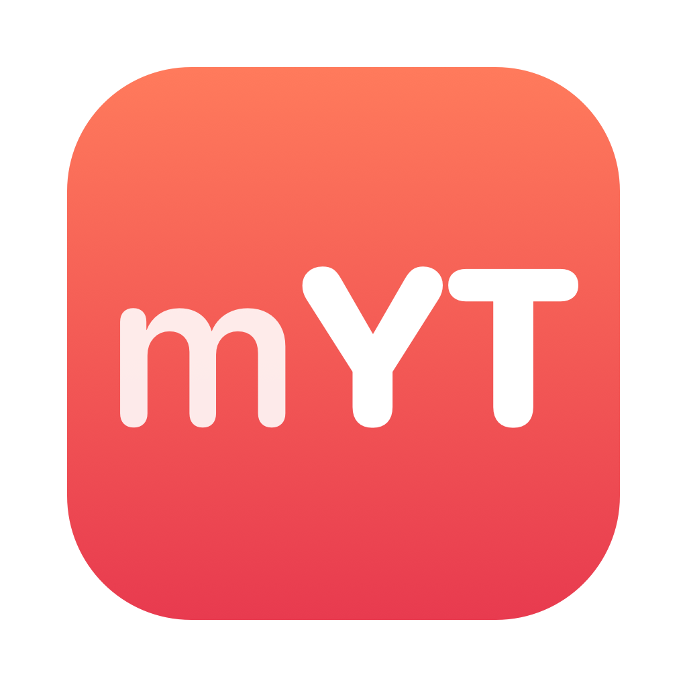

<div align="center">



# ytmini

A small, fast desktop YouTube client for macOS and Windows.
Your own account, no browser tab, no ads in the way.

[](https://github.com/dennissoftman/ytmini/actions/workflows/ci.yml)
[](https://github.com/dennissoftman/ytmini/releases/latest)
[](https://github.com/dennissoftman/ytmini/releases)
[](LICENSE.md)


</div>

ytmini is a native app (Rust, [egui](https://github.com/emilk/egui) and
[libmpv](https://mpv.io)) that signs in with the YouTube session from your
browser and gives you your feed, subscriptions, Watch later, history and
playlists in a quick, quiet window, with mpv doing the playback.

> ytmini is an unofficial client. It is not affiliated with, endorsed by or
> connected to YouTube or Google. It uses YouTube's private web API, which can
> change at any time.

## Features

- **Your YouTube**: Home with category chips, Subscriptions, Watch later,
  History, playlists, channels and search, signed in as you.
- **Fast starts**: stream links are looked up directly (about 0.2 s, macOS
  for now) with [yt-dlp](https://github.com/yt-dlp/yt-dlp) as the fallback;
  the next video is prepared ahead and videos start preparing when you hover
  them.
- **Embedded mpv player**: hardware decoding, chapters, seek-bar previews,
  quality that follows battery and Low Power Mode, YouTube's keyboard
  shortcuts, fullscreen.
- **Up next**: a queue you can reorder, autoplay, and YouTube's related videos.
- **Music**: songs are recognised, get song-only suggestions, keep playing in a
  small card when you go back, and get an automatic EQ preset per genre.
- **Background play**: minimise or close to the tray and audio keeps going,
  autoplay included.
- **Extras**: [SponsorBlock](https://sponsor.ajay.app) segment skipping,
  [DeArrow](https://dearrow.ajay.app) titles and thumbnails (experimental),
  downloads, comments (read-only), like / subscribe / save to playlist,
  continue where you left off.
- **13 interface languages**, with YouTube's language and region set
  separately.

## Install

Download the latest build from
[Releases](https://github.com/dennissoftman/ytmini/releases/latest).

| Platform | File | Notes |
|---|---|---|
| macOS 15+ (Apple Silicon) | `ytmini-<version>-macos-arm64.zip` | Unzip and move `ytmini.app` to Applications. The app isn't signed: the first time, right-click it → **Open**, or run `xattr -dr com.apple.quarantine /Applications/ytmini.app`. |
| Windows 10/11 (x64) | `ytmini-<version>-setup.exe` | Per-user install, no admin rights. SmartScreen may warn about an unknown publisher: **More info → Run anyway**. A portable zip is attached too. |

On first launch ytmini downloads [yt-dlp](https://github.com/yt-dlp/yt-dlp)
and [deno](https://deno.com) from their official GitHub releases (checksums
verified) and keeps yt-dlp up to date.

### Signing in

ytmini reads the YouTube session from a browser you're already signed in to:
Firefox (macOS and Windows), Chrome, Brave, Edge, Chromium, Opera and Vivaldi
(macOS; one Keychain prompt), or Safari (needs Full Disk Access). Google blocks
sign-in inside embedded web views, and OAuth doesn't give access to the feed,
history or Watch later, so this is the only way to see your own YouTube.

Only cookies for `youtube.com` and Google sign-in are copied. They stay in
ytmini's own settings folder (readable only by you) and are sent nowhere but
YouTube. When Google retires the copy, ytmini refreshes it from the same
browser.

## How it works

| Job | How |
|---|---|
| Lists (feed, subscriptions, Watch later, history, playlists, search, channels) | YouTube's web API with your session ([`innertube.rs`](src/innertube.rs)); yt-dlp if a reply can't be read |
| Stream links | asked from YouTube's player API directly, with YouTube's JS challenges solved by yt-dlp's own solver in a deno process with no permissions ([`native.rs`](src/native.rs)); anything unexpected falls back to warm yt-dlp helpers ([`resolver.rs`](src/resolver.rs)) |
| Playback | libmpv's OpenGL render API inside the window ([`mpv.rs`](src/mpv.rs), [`player.rs`](src/player.rs)); a separate mpv window if libmpv can't load |
| Sign-in | your browser's cookie store, read directly ([`signin.rs`](src/signin.rs)) |
| Likes, subscriptions, Watch later edits, history | YouTube's web API |

libmpv is loaded at runtime, not linked, so `cargo build` works without mpv
installed and the app still starts if libmpv is missing.

Third-party services get no cookies: SponsorBlock and DeArrow receive the video
id, Deezer (Auto EQ) the artist and title.

### Where things live

| | macOS | Windows |
|---|---|---|
| Settings, session, logs, yt-dlp/deno | `~/Library/Application Support/ytmini/` | `%APPDATA%\ytmini\` |
| Cache (thumbnails, lists) | `~/Library/Caches/ytmini/` | `%LOCALAPPDATA%\ytmini\` |

## Build from source

Needs [Rust](https://rustup.rs) (stable).

```bash
cargo build --release
```

**macOS app bundle** (needs [Homebrew](https://brew.sh) mpv on the build
machine; the result doesn't need Homebrew):

```bash
brew install mpv
./bundle.sh            # dist/ytmini.app
./bundle.sh --install  # and copy it to ~/Applications
```

`./run.sh` installs mpv if missing and runs a development build.

**Windows installer**, cross-compiled from macOS (needs `cargo-xwin`, LLVM,
`makensis`, `gh`):

```bash
./scripts/build_windows.sh   # dist/ytmini-<version>-setup.exe and a portable zip
```

## Contributing

Bug reports and pull requests are welcome. Please read
[CONTRIBUTING.md](CONTRIBUTING.md) first: it covers the privacy rules, how to
test without touching your own watch history, translations and the commit
style that drives releases.

## License

ytmini's own code is [MIT](LICENSE.md). The released app bundles mpv and
FFmpeg (GPL), so the macOS and Windows packages as a whole are distributed
under the GNU GPL v3; see [NOTICE.md](NOTICE.md).
